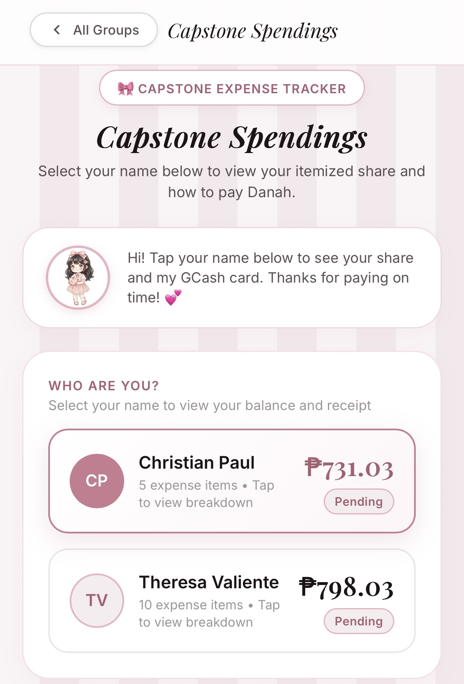
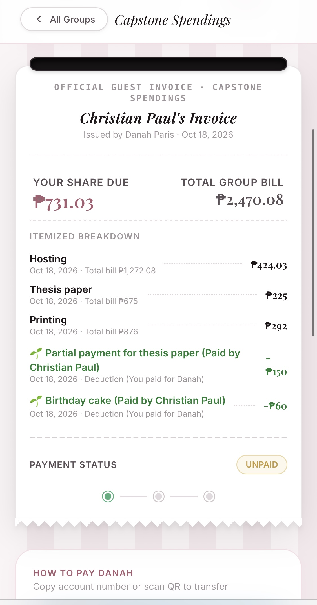
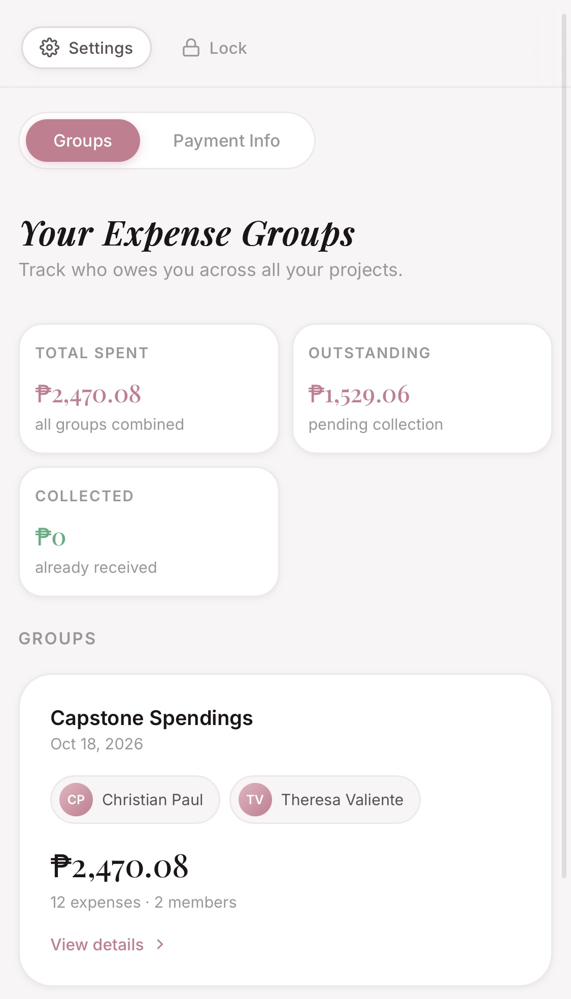
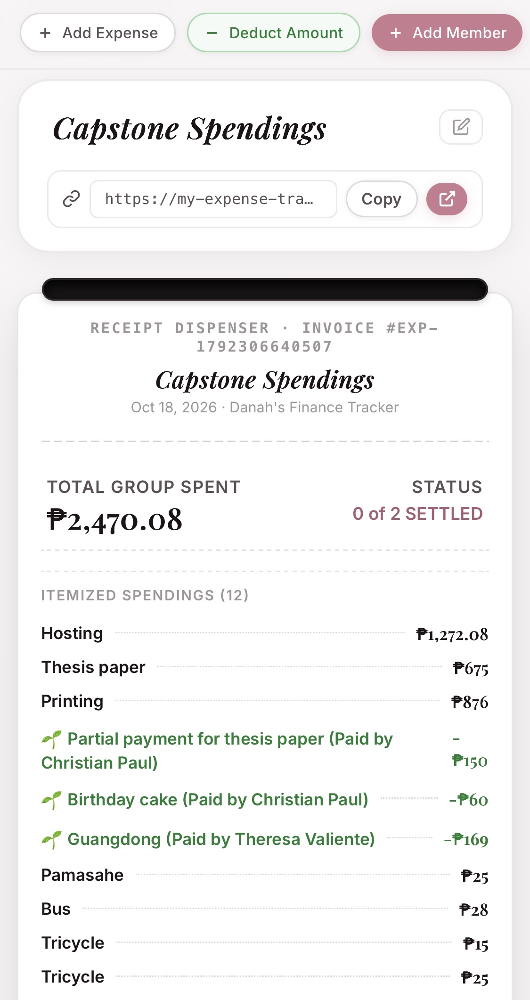
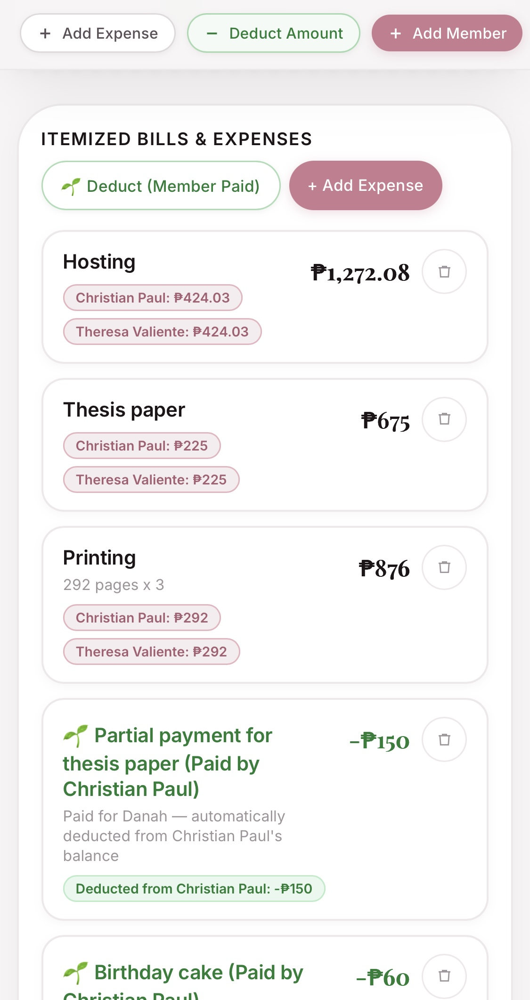
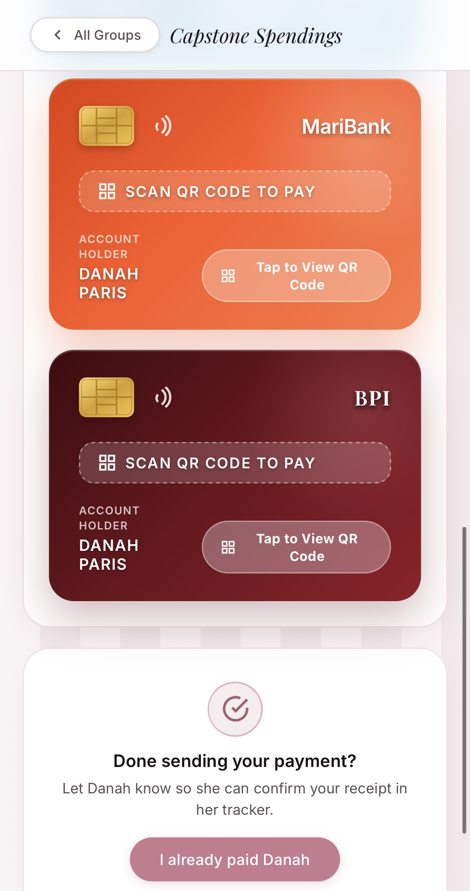
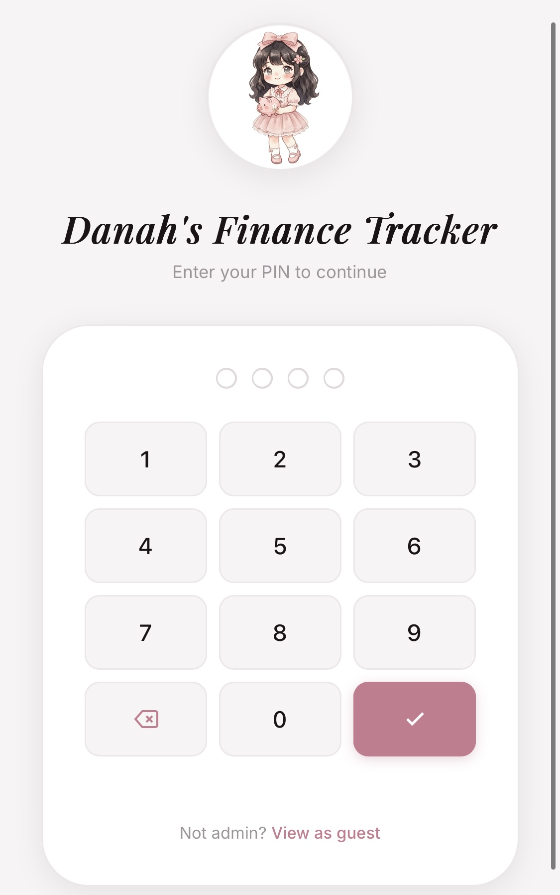

<p align="center">
  
</p>

<h1 align="center">Danah's Finance Tracker</h1>

<p align="center">
  <em>An elegant, coquette-aesthetic group expense and balance tracker crafted for university capstone and thesis project teams.</em>
</p>

<p align="center">
  <a href="https://my-expense-tracker-topaz.vercel.app/?group=g_1792306640507">
    <strong>🤍 Click Here to View Live Group Demo</strong>
  </a>
</p>

<p align="center">
  <code>https://my-expense-tracker-topaz.vercel.app/?group=g_1792306640507</code>
</p>

---

## 🤍 Overview

In college capstone and thesis groups, members constantly incur shared bills—thesis paper printing, binding, server hosting, commuting, and food. When one person (**Danah**) fronts the expenses, keeping track of who owes what can quickly become messy and uncomfortable.

**Danah's Finance Tracker** provides a chic, transparent, and frictionless solution. Team members do not need to download an app or register—they simply open their group link on mobile to view their itemized invoice and pay directly via GCash, MariBank, or BPI.

---

## 🤍 Paper Receipt Invoice Dispenser

The signature interface of the tracker is a realistic paper receipt dispenser that itemizes group expenses, tracks settlement progress, and computes each member's exact dues.

<p align="center">
  
</p>

- **Itemized Bills**: Clear breakdown of all spending categories with timestamps.
- **Upfront Payer Record**: Displays Danah as the upfront payer with all receipts tracked.
- **Settlement Stepper**: Visual multi-step progress indicator (`Pending` → `In Review` → `Paid in Full`).
- **Sawtooth Tear Border**: Classic paper receipt aesthetic tailored with a soft, muted blush color palette.

---

## 🤍 Features Showcase

### 🤍 Admin Dashboard & Expense Groups
Manage multiple project billing groups in one centralized view. A compact 2×2 mobile statistics row keeps track of Total Spent, Outstanding collections, and Collected funds without consuming vertical screen space.

<p align="center">
  
</p>

---

### 🤍 Flexible Splits & Member Deductions
Easily add expenses with flexible split modes: equal division across members, custom peso values, or member-specific bills. If a member covers Danah's commute fare or food, Danah can record a **Deduction** that automatically reduces what that member owes.

<p align="center">
  
  
</p>

- **Equal Split with Payer**: Automatically accounts for Danah's personal share or splits exclusively among members.
- **Custom Amount Verification**: Flags any remainder or surplus with prompt confirmation.
- **Automatic Deductions**: Deductions display highlighted in green with a `🌱` badge and subtract directly from balances.

---

### 🤍 Payment Cards & QR Code Scanning
Team members can transfer payments easily using dedicated digital payment cards.

<p align="center">
  
</p>

- **GCash**: Clean e-wallet styling with one-tap account number copying and QR view.
- **MariBank**: Signature orange branding with 11-digit account formatting.
- **BPI**: Banking card styling with 10-digit account formatting.
- **QR Code Modal**: Upload or view base64 QR codes directly on any mobile device.

---

### 🤍 Tactile PIN Security
A private 4-digit PIN lock screen protects the admin dashboard from unauthorized modifications while offering guests a direct link to their shared project views.

<p align="center">
  
</p>

---

## 🤍 Architecture & Tech Stack

- **Frontend**: Pure HTML5, Vanilla CSS3 (Custom Design Tokens, Typography Hierarchy, Responsive Media Queries), Vanilla JavaScript (ES6+).
- **Typography**: Playfair Display (Serif) & Inter (Sans-Serif).
- **Cloud Persistence**: Supabase (PostgreSQL with Row Level Security).
- **Serverless Configuration**: Vercel Serverless Function (`api/config.js`) for secure, environment-variable-driven database connectivity.
- **Hosting**: Vercel with single-page application URL rewrites.

---

## 🤍 Quick Setup & Deployment

### 1. Local Development
```bash
git clone https://github.com/danahparis21/my-expense-tracker.git
cd my-expense-tracker
open index.html
```

### 2. Connect Supabase & Deploy to Vercel
1. Run [`supabase_schema.sql`](./supabase_schema.sql) in your Supabase project's SQL Editor.
2. Deploy the repository to Vercel and define the following Environment Variables in your Vercel Project Settings:
   - `SUPABASE_URL`: `https://your-project.supabase.co`
   - `SUPABASE_ANON_KEY`: `your-anon-publishable-key`
3. Vercel automatically deploys your project with zero manual client-side key entry required.

---

<p align="center">
  <em>Made with care for Capstone and Thesis Project Teams.</em>
</p>
